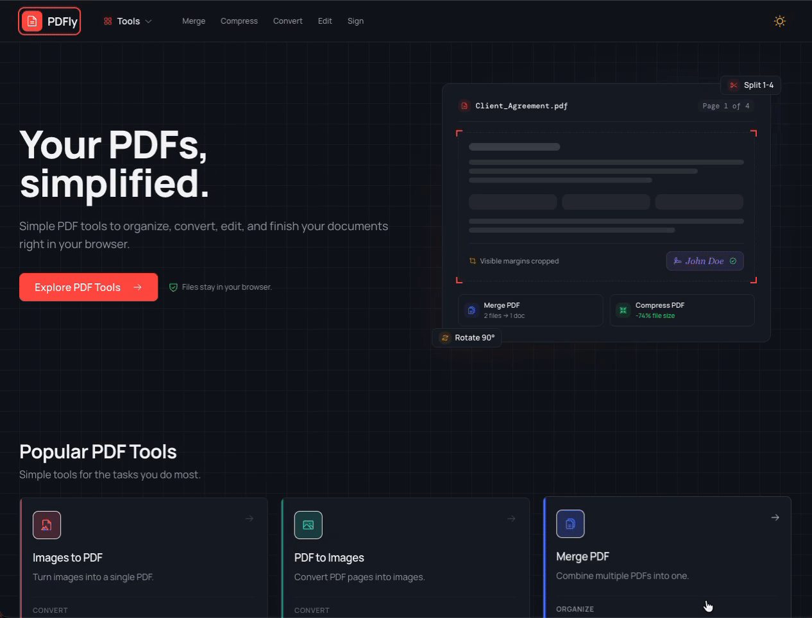
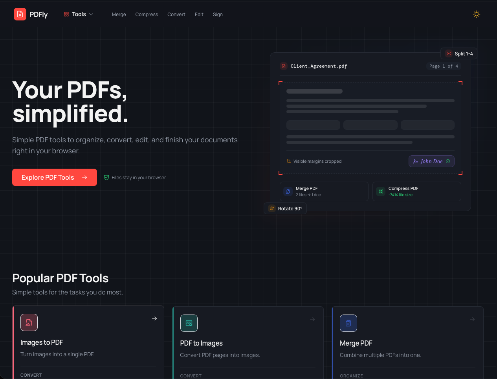
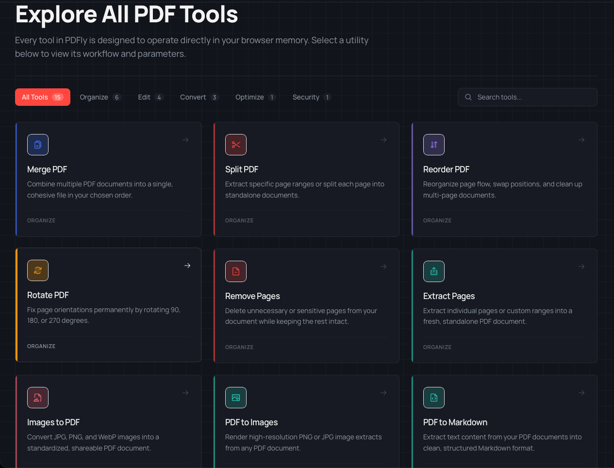
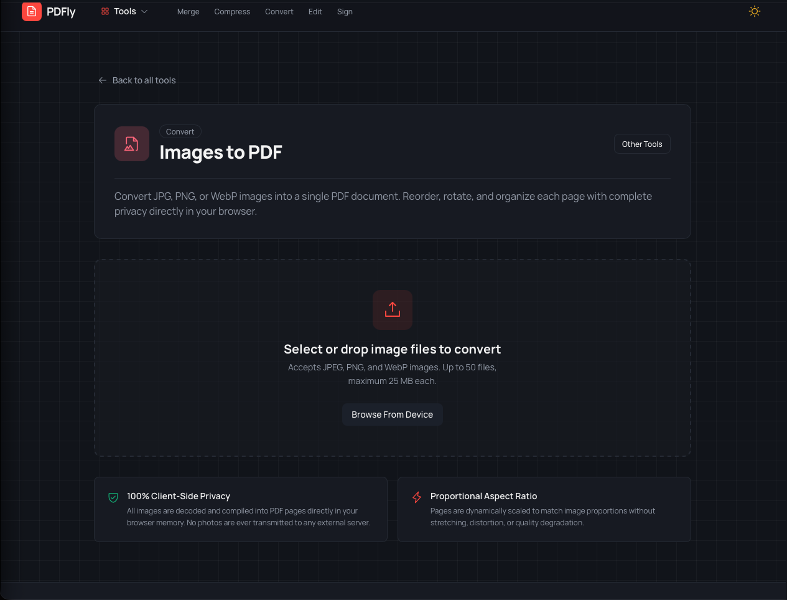
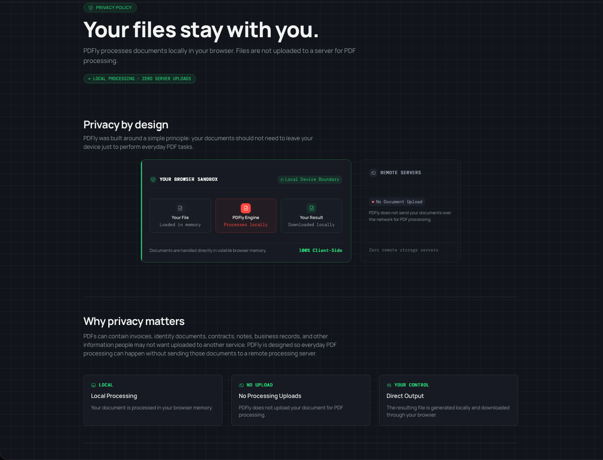

<div align="center">

# 📄 PDFly — Simple PDF Tools, Right in Your Browser

**Your PDFs. Your browser. Your control.**

A privacy-focused PDF toolkit for everyday document tasks — organize, convert, edit, and finish documents directly in your browser.

<p align="center">
  
</p>

<p align="center">
  <a href="https://pdfly-rho.vercel.app/"><strong>🌐 Open PDFly</strong></a>
  &nbsp;·&nbsp;
  <a href="https://github.com/Krishnendu1910/PDFly"><strong>💻 View Source</strong></a>
  &nbsp;·&nbsp;
  <a href="https://github.com/Krishnendu1910/PDFly/issues"><strong>🐛 Report an Issue</strong></a>
</p>

<p align="center">
  
  
  
  
</p>

<p align="center">
  
  
  
</p>

</div>

---

## 🧭 Table of Contents

- [✨ What Is PDFly?](#-what-is-pdfly)
- [🖼️ Product Preview](#️-product-preview)
- [🔐 Privacy Comes First](#-privacy-comes-first)
- [🧰 Features](#-features)
- [🚀 How to Use PDFly](#-how-to-use-pdfly)
- [🛠️ Tech Stack](#️-tech-stack)
- [🏗️ Run PDFly Locally](#️-run-pdfly-locally)
- [🔒 Security and Engineering](#-security-and-engineering)
- [⚙️ Production Build](#️-production-build)
- [☁️ Deployment](#️-deployment)
- [⚠️ Limitations](#️-limitations)
- [🗺️ What's Next?](#️-whats-next)
- [💬 Feedback and Contributions](#-feedback-and-contributions)
- [📄 License](#-license)
- [👨‍💻 Author](#-author)

---

## ✨ What Is PDFly?

**PDFly** is a browser-based PDF toolkit built to make everyday document tasks simple, accessible, and privacy-conscious.

Many online PDF services upload documents to remote servers for processing. PDFly takes a different approach: **supported PDF operations are processed locally in your browser, without uploading files to a backend for processing.**

Use PDFly to organize pages, convert images, merge documents, compress supported content, add page numbers, and perform other common PDF tasks — all from one interface.

> [!IMPORTANT]
> PDFly is designed for client-side processing. Browser-local processing is not a guarantee that every file or every operation will work perfectly; compatibility depends on the document, operation, and browser.

## 🖼️ Product Preview

### 🏠 Homepage

The homepage introduces PDFly and provides quick access to popular PDF utilities.

<p align="center">
  
</p>

### 🧰 Explore All PDF Tools

Browse the available utilities, filter tools by category, and search for a specific workflow.

<p align="center">
  
</p>

### 🖼️ Images to PDF

Select or drop supported image files, then convert them into a PDF directly in the browser.

<p align="center">
  
</p>

### 🔐 Privacy by Design

PDFly is built around the principle that documents should not need to leave your device just to perform everyday PDF tasks.

<p align="center">
  
</p>

## 🔐 Privacy Comes First

PDFly is designed to keep document processing under the user's control.

- 🖥️ **Local processing:** Supported document operations run directly in your browser.
- 🚫 **No processing uploads:** Files are not uploaded to a backend for PDF processing.
- 🧭 **No document-processing telemetry:** PDFly does not use analytics or telemetry to track document processing.
- 📥 **Direct downloads:** Generated files can be downloaded directly to your device.

> **Your documents should remain under your control.**

The privacy claims above describe the intended document-processing design. Hosting, browser extensions, device security, and other parts of a user's environment remain outside the application's control.

## 🧰 Features

PDFly includes **15 PDF tools** for everyday document workflows.

| Tool | What it does |
|---|---|
| 📑 **Merge PDF** | Combine multiple PDFs into one document. |
| ✂️ **Split PDF** | Divide a PDF into separate documents using pages or ranges. |
| 🔀 **Reorder PDF** | Rearrange pages into your preferred sequence. |
| 🔄 **Rotate PDF** | Rotate individual pages or an entire document. |
| 🗑️ **Remove Pages** | Remove unwanted pages from a PDF. |
| 📃 **Extract Pages** | Select specific pages and create a new PDF. |
| 🖼️ **Images to PDF** | Turn supported images into a PDF document. |
| 🎞️ **PDF to Images** | Render PDF pages as images. |
| 📝 **PDF to Markdown** | Extract document text into Markdown-oriented content. |
| 📦 **Compress PDF** | Reduce PDF file size through supported image optimization. |
| 🔢 **Page Numbers** | Add page numbers to your document. |
| 💧 **Watermark PDF** | Add customizable text watermarks. |
| 📐 **Crop PDF** | Adjust visible page boundaries. |
| ✍️ **Sign PDF** | Place a visual signature on PDF pages. |
| 🔒 **Protect / Unlock PDF** | Apply password protection or unlock supported encrypted PDFs. |

<sub>Results depend on document structure, browser capabilities, and the operation being performed.</sub>

## 🚀 How to Use PDFly

No installation is required to use the live website.

1. 🌐 **Open PDFly:** Visit [pdfly-rho.vercel.app](https://pdfly-rho.vercel.app/).
2. 🧰 **Choose a tool:** Select the PDF operation you need.
3. 📂 **Add your file:** Select a PDF or supported image files from your device.
4. ⚙️ **Configure the operation:** Choose pages, settings, output options, or other available controls.
5. ⚡ **Process your document:** Let your browser perform the supported operation.
6. 📥 **Download your result:** Review the output filename and download the generated file.

**That's it — no account is required to get started.**

## 🛠️ Tech Stack

| Category | Technologies |
|---|---|
| ⚛️ Frontend | React 19, TypeScript |
| ⚡ Build Tool | Vite |
| 🎨 Styling | Tailwind CSS v4 |
| 🧭 Routing | React Router |
| 🎞️ Animation | Framer Motion |
| 🔤 Typography | Manrope, DM Mono |
| 🎯 Icons | Phosphor Icons |
| 📄 PDF Manipulation | `pdf-lib` |
| 🔍 PDF Rendering and Text Extraction | PDF.js (`pdfjs-dist`) |
| 🔐 Encryption and Decryption | QPDF WebAssembly |
| 🧵 Background Processing | Web Workers where applicable |
| 🧪 Testing | Vitest, React Testing Library |
| 🧹 Code Quality | ESLint, TypeScript type checking |
| ☁️ Deployment | Vercel |

## 🏗️ Run PDFly Locally

### 📋 Prerequisites

- [Node.js](https://nodejs.org/) — use a version supported by the project's dependencies.
- **npm** — included with Node.js.
- [Git](https://git-scm.com/).

### 1️⃣ Clone the repository

```bash
git clone https://github.com/Krishnendu1910/PDFly.git
cd PDFly
```

### 2️⃣ Install dependencies

```bash
npm install
```

### 3️⃣ Start the development server

```bash
npm run dev
```

Open the local URL printed in your terminal, typically `http://localhost:5173`.

### 4️⃣ Run checks

```bash
# Run tests
npm test -- --run

# Check code quality
npm run lint

# Check TypeScript types
npm run type-check

# Create a production build
npm run build
```

> Run the commands in your local environment to verify the current checkout; this README does not imply that checks have already passed on every commit.

## 🔒 Security and Engineering

PDF processing requires careful handling of untrusted files and browser resources. PDFly incorporates safeguards intended to make document handling more robust.

- 🛡️ **Hardened PDF.js configuration:** Embedded scripting is disabled, and dynamic evaluation support is turned off.
- 📏 **Defensive resource limits:** Limits apply to selected page operations, cumulative merge size, image batches, and canvas dimensions.
- 🔐 **Encrypted document handling:** Encrypted PDFs are handled explicitly rather than silently bypassing encryption checks.
- 🧼 **Output filename sanitization:** Generated filenames are sanitized to reduce risks from unsafe names and path-like input.
- ♻️ **Resource cleanup:** Temporary object URLs and PDF.js document resources are cleaned up when no longer needed.
- ✅ **Output validation:** Generated PDF output is checked for the expected PDF file signature before downloading.

PDFly is designed to process documents locally, but client-side processing does not eliminate every possible risk or guarantee that every PDF will work correctly.

## ⚙️ Production Build

Create an optimized production build:

```bash
npm run build
```

Vite generates the production files in the `dist/` directory.

To preview the build locally:

```bash
npm run preview
```

## ☁️ Deployment

PDFly is a client-side single-page application and does not require a dedicated application backend for its supported PDF operations.

### Deploy with Vercel

1. Push your repository to GitHub.
2. Sign in to [Vercel](https://vercel.com/).
3. Import the PDFly repository.
4. Confirm the build command is `npm run build`.
5. Set the output directory to `dist`.
6. Deploy the application.

Ensure the hosting platform supports **SPA route fallback**, so direct visits to routes such as `/tools/merge` resolve correctly.

## ⚠️ Limitations

- 🧠 **Browser memory:** Large PDFs and image-heavy documents may consume substantial memory.
- 💻 **Device performance:** Processing speed depends on the device, browser, and document complexity.
- 🔐 **Encrypted PDFs:** Support depends on the operation and encryption format; unsupported documents may fail.
- 📄 **PDF compatibility:** Complex layouts, unusual fonts, scanned documents, and damaged files may produce imperfect results.
- 🖼️ **Image conversion:** High-resolution pages can require significant memory and processing time.
- 🧰 **Feature scope:** PDFly focuses on its existing tools; it does not claim to replace every professional PDF editor.

## 🗺️ What's Next?

PDFly focuses on essential PDF workflows already available. Potential future improvements include:

- [ ] 🩹 PDF repair
- [ ] 🧱 PDF flattening
- [ ] 🖍️ Secure redaction
- [ ] 🧹 Metadata removal
- [ ] 📷 PDF scanning
- [ ] ⚡ Further performance, compatibility, and usability improvements

These are possible future additions, not promises of availability in the current release.

## 💬 Feedback and Contributions

**Your feedback can help shape the next version of PDFly.**

- What worked well?
- What was confusing?
- Did you encounter a bug?
- Which feature would make PDFly more useful?

<p align="center">
  <a href="https://pdfly-rho.vercel.app/"><strong>🌐 Try PDFly</strong></a>
  &nbsp;·&nbsp;
  <a href="https://github.com/Krishnendu1910/PDFly/issues"><strong>🐛 Report an Issue</strong></a>
  &nbsp;·&nbsp;
  <a href="https://github.com/Krishnendu1910/PDFly"><strong>⭐ Star on GitHub</strong></a>
</p>

## 📄 License

PDFly is currently **private and proprietary**. All rights reserved.

The source repository is available for viewing under its current access settings; viewing or cloning the code does not grant permission to redistribute, modify, or commercially use it without authorization.

---

<div align="center">

### 📄 PDFly

**Your PDFs. Your browser. Your control.**

Built with care by **Krishnendu Sarkar**.

[LinkedIn](https://www.linkedin.com/in/krishnendu-sarkar19/) · [GitHub](https://github.com/Krishnendu1910) · [Live Website](https://pdfly-rho.vercel.app/)

</div>
